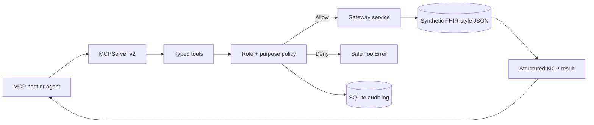

# MCP Healthcare Data Gateway

A policy-enforced Model Context Protocol server that exposes synthetic FHIR-style healthcare data to AI applications through typed tools, safe resources, and a guided prompt.

  

> **Synthetic data and portfolio use only.** This repository contains no real protected health information. It is not a clinical system, does not provide medical advice, and is not a substitute for a security, privacy, legal, or clinical governance review.

## Why this project

AI agents need a standard way to discover and call data tools, but healthcare access cannot be an unrestricted database connection. This gateway demonstrates how an MCP server can combine protocol interoperability with least-privilege policies, field redaction, structured outputs, and durable access auditing.

## Capabilities

### Tools

| Tool | Authorized use |
|---|---|
| `search_patients` | Treatment/operations directory search; receptionist results are redacted |
| `get_patient_summary` | Clinicians and care coordinators with treatment purpose |
| `list_observations` | Treatment access with an optional observation-code filter |
| `aggregate_encounters` | Deidentified counts for analyst + analytics purpose |

### Resources

- `healthcare://metadata` — non-sensitive server and dataset metadata
- `healthcare://policy/access` — human-readable access policy

### Prompt

- `care_coordination_brief` — guides a host to call the summary tool, stay grounded in returned data, cite resource IDs, and include a non-medical-advice notice

## Architecture



The protocol layer is intentionally thin. Policy, repository, audit, and gateway logic are separate modules so they can be unit-tested and replaced independently.

## Access model

| Role | Purpose | Patient search | Clinical detail | Aggregates |
|---|---|---:|---:|---:|
| Clinician | Treatment | Yes | Yes | No |
| Care coordinator | Treatment | Yes | Yes | No |
| Receptionist | Operations | Yes, redacted | No | No |
| Analyst | Analytics | No | No | Yes, deidentified |

Every allow and deny decision is written to SQLite with requester, role, purpose, operation, target, timestamp, and policy reason.

## Run locally

1. Create and activate a virtual environment.

   ```bash
   python3 -m venv .venv
   source .venv/bin/activate
   ```

2. Install development dependencies.

   ```bash
   python -m pip install -r requirements-dev.txt
   ```

3. Run quality checks and the in-process MCP client.

   ```bash
   ruff check .
   pytest --cov=app --cov-report=term-missing
   python -m scripts.smoke_client
   ```

## Run with an MCP host

### Stdio

```bash
python -m app.server
```

Example host configuration:

```json
{
  "mcpServers": {
    "healthcare-gateway": {
      "command": "/absolute/path/to/.venv/bin/python",
      "args": ["-m", "app.server"],
      "cwd": "/absolute/path/to/mcp-healthcare-data-gateway"
    }
  }
}
```

### Streamable HTTP

```bash
MCP_TRANSPORT=streamable-http python -m app.server
```

The MCP endpoint is available at `http://localhost:8000/mcp`.

### MCP Inspector

```bash
mcp dev app/server.py
```

The Inspector uses Node.js through `npx` and is intended for local development.

## Example tool arguments

```json
{
  "patient_id": "SYN-P001",
  "requester_id": "demo-clinician",
  "role": "clinician",
  "purpose": "treatment"
}
```

## Security boundaries

- The bundled `requester_id`, `role`, and `purpose` arguments demonstrate authorization policy behavior; they are **not authentication**.
- A production deployment must derive identity and scopes from verified OAuth tokens rather than trusting tool arguments.
- Do not log clinical payloads or secrets; this project audits decisions and identifiers only.
- Use encrypted transport and storage, secret management, tenant isolation, rate limits, monitoring, and retention controls.
- Perform threat modeling, prompt-injection testing, access reviews, and applicable regulatory assessments before real-world use.

## Current MCP SDK

This project targets the stable MCP Python SDK v2 interface: `MCPServer`, in-process `Client(server)` tests, stdio for local hosts, and Streamable HTTP for deployment. The dependency is constrained to `mcp>=2,<3` so future major protocol changes do not silently break the project.

## Next steps

- integrate an OAuth authorization server and derive scopes from verified tokens;
- replace JSON with a FHIR server adapter and explicit field-level mappings;
- add SMART-on-FHIR audience and patient-context checks;
- export audit events to a tamper-evident security pipeline;
- add consent, encounter relationship, and emergency-access workflows;
- deploy behind a gateway with OpenTelemetry, rate limits, and policy metrics.

